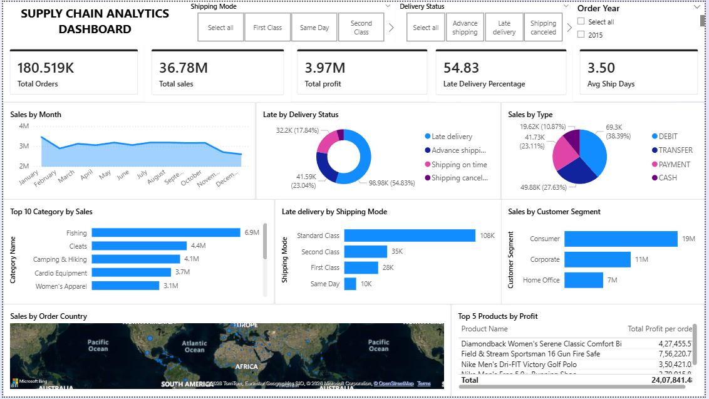

# 📦 Supply Chain Analytics – Delivery Delay & Performance Analysis

An end-to-end Data Analytics project focused on analyzing supply chain operations, identifying delivery delays, evaluating logistics performance, and uncovering sales and operational trends using Python and Power BI.

---

## 📌 Project Overview

Efficient supply chain management plays an important role in customer satisfaction, order fulfillment, and business profitability.

This project analyzes the **DataCo Smart Supply Chain Dataset** to understand delivery performance, identify logistics bottlenecks, explore sales trends, and evaluate operational efficiency.

Using Python for data cleaning and exploratory data analysis and Power BI for interactive visualization, the project transforms raw supply chain data into meaningful business insights and actionable recommendations.

## 🎯 Business Objectives

- Analyze delivery status distribution and identify late delivery patterns.
- Investigate region-wise, customer segment-wise, and category-wise delivery performance.
- Understand the impact of shipping mode and payment type on delivery delays.
- Analyze monthly order volume trends.
- Identify top-performing products and categories based on sales and profit.
- Identify cities with high order frequency and late delivery counts.
- Provide business recommendations to improve logistics and delivery efficiency.

## 📊 Dataset Information

- **Dataset:** DataCo Smart Supply Chain Dataset
- **Source:** Kaggle
- **Domain:** E-commerce and Supply Chain Operations
- **Target Feature:** Delivery Status
- **Engineered Feature:** `is_late`

The dataset contains transactional supply chain information, including:

- Customer demographics and segments.
- Order details and order dates.
- Product categories and product names.
- Shipping modes and delivery information.
- Sales and profitability metrics.
- Geographic and regional information.

**Dataset Source:** [DataCo Smart Supply Chain for Big Data Analysis – Kaggle](https://www.kaggle.com/datasets/shashwatwork/dataco-smart-supply-chain-for-big-data-analysis)

The dataset is not included in this repository due to its size. Download it from Kaggle and place the original CSV in the repository's root directory before running the notebook.

## 🛠️ Tools & Technologies

| Technology | Purpose |
|---|---|
| Python | Data analysis and preprocessing |
| Pandas | Data manipulation and cleaning |
| NumPy | Numerical operations |
| Matplotlib | Data visualization |
| Seaborn | Statistical visualization |
| Jupyter Notebook | Exploratory data analysis |
| Power BI | Interactive dashboard development |

## 🔄 Project Workflow

### 1. Data Loading and Exploration

- Loaded the DataCo Supply Chain Dataset using Pandas.
- Examined dataset dimensions, data types, and column information.
- Analyzed descriptive statistics and unique values.
- Explored delivery status and order distributions.
- Identified irrelevant columns and data quality issues.

### 2. Data Cleaning and Feature Engineering

- Removed 21 irrelevant and personally identifiable information (PII) or redundant columns.
- Created an `is_late` binary feature to identify late deliveries.
- Engineered `Delay_ship_days` using scheduled and actual shipping days.
- Converted order dates into datetime format.
- Extracted Order Year and Order Month for time-based analysis.
- Retained relevant customer, order, product, shipping, financial, and delivery information.

### 3. Delivery Performance Analysis

Analyzed delivery performance across multiple business dimensions.

Key analysis areas:

- Delivery status distribution.
- Region-wise late delivery percentage.
- Customer segment-wise late delivery percentage.
- Product category-wise late delivery percentage.
- Shipping mode versus late deliveries.
- Payment type versus late deliveries.

### 4. Sales and Logistics Performance Analysis

Explored sales and operational performance to identify business trends.

Analysis included:

- Sales by product category.
- Monthly order volume trends.
- Top 10 products by sales.
- Top 10 categories by sales.
- Top 10 categories by average profit.
- Top 10 categories by total profit.

### 5. Geographic Analysis

Evaluated regional sales and delivery performance.

Key analysis areas:

- Top 10 cities by sales.
- Top 10 cities by order frequency.
- Top 10 cities with the highest late delivery counts.

### 6. Product Demand Analysis

- Identified the top 10 most purchased products based on total order item quantity.
- Compared product demand across categories.
- Explored product performance to support inventory and demand planning.

## 📊 Power BI Dashboard

Developed an interactive Power BI dashboard to present key supply chain performance indicators and operational trends.

The dashboard provides insights into:

- Delivery status distribution.
- Late delivery performance.
- Regional delivery performance.
- Sales by category.
- Monthly order trends.
- Product and category performance.
- Geographic sales and delivery patterns.

**Dashboard File:** `Supply_Chain_Dashboard.pbix`

## 🖥️ Dashboard Preview



## 🔍 Key Business Insights

- A significant proportion of orders experience late delivery, with certain regions and shipping modes showing higher delivery challenges.
- Standard Class shipping contributes the highest volume of late deliveries.
- Certain product categories demonstrate higher late delivery rates, indicating potential inventory or fulfillment challenges.
- Monthly order volumes show seasonal patterns that can support demand planning.
- A smaller group of cities and products contributes substantially to sales and delivery activity, making them important areas for operational monitoring.

## 💡 Business Recommendations

- Review shipping performance, especially for Standard Class deliveries.
- Monitor regions with consistently higher late delivery rates.
- Investigate product categories experiencing frequent delivery delays.
- Use monthly order trends to improve demand and inventory planning.
- Prioritize cities with high late delivery counts for logistics improvements.
- Monitor sales and profitability across product categories to support business decisions.

## 📁 Project Files

| File | Description |
|---|---|
| `Supply_Chain_Analysis.ipynb` | Complete Python data analysis and EDA notebook |
| `Supply_Chain_Dashboard.pbix` | Interactive Power BI dashboard |
| `Supply_chain_analytics_dashboard.png` | Dashboard screenshot |
| `requirements.txt` | Python dependencies |
| `.gitignore` | Files excluded from Git tracking |

## ⚙️ How to Run the Project

### 1. Clone the repository

```bash
git clone https://github.com/kirana-23/Supply-Chain-Analytics-Delivery-Delay-End-End-Analysis.git
```

### 2. Navigate to the project directory

```bash
cd Supply-Chain-Analytics-Delivery-Delay-End-End-Analysis
```

### 3. Create a virtual environment

```bash
python -m venv venv
```

### 4. Activate the environment

Windows:

```bash
venv\Scripts\activate
```

### 5. Install dependencies

```bash
pip install -r requirements.txt
```

### 6. Launch Jupyter Notebook

```bash
jupyter notebook
```

Open `Supply_Chain_Analysis.ipynb` and run the notebook.

### 7. Download the dataset

Download the DataCo Supply Chain Dataset from Kaggle and place the original CSV in the repository's root directory.

Ensure the dataset filename and notebook file path match.

## 🚀 Future Enhancements

- Develop predictive models for delivery delay classification.
- Identify key factors contributing to late deliveries using statistical analysis.
- Build interactive delivery performance monitoring dashboards.
- Integrate automated reporting for supply chain KPIs.
- Explore demand forecasting to support inventory planning.

## ⚠️ Limitations

- The analysis is based on historical supply chain transaction data.
- Observed relationships do not necessarily establish causation.
- Historical delivery patterns may not represent future logistics performance.
- Business recommendations should be validated against current operational conditions.

## 👩‍💻 Author

**Kirana B**

Data Analytics | Python | SQL | Power BI | Excel

GitHub: [kirana-23](https://github.com/kirana-23)

---

⭐ If you find this project useful, feel free to explore the repository!
